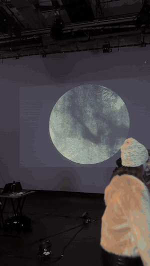
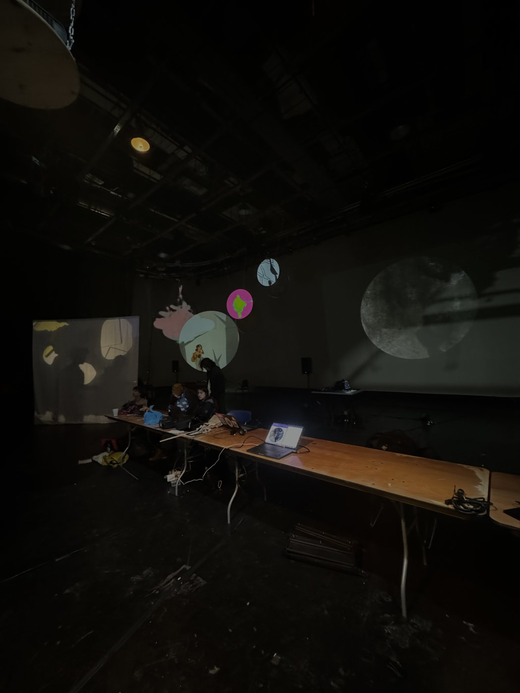
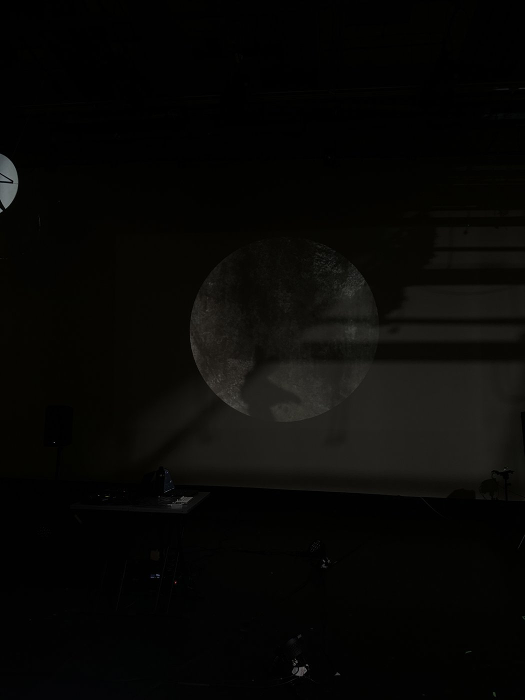
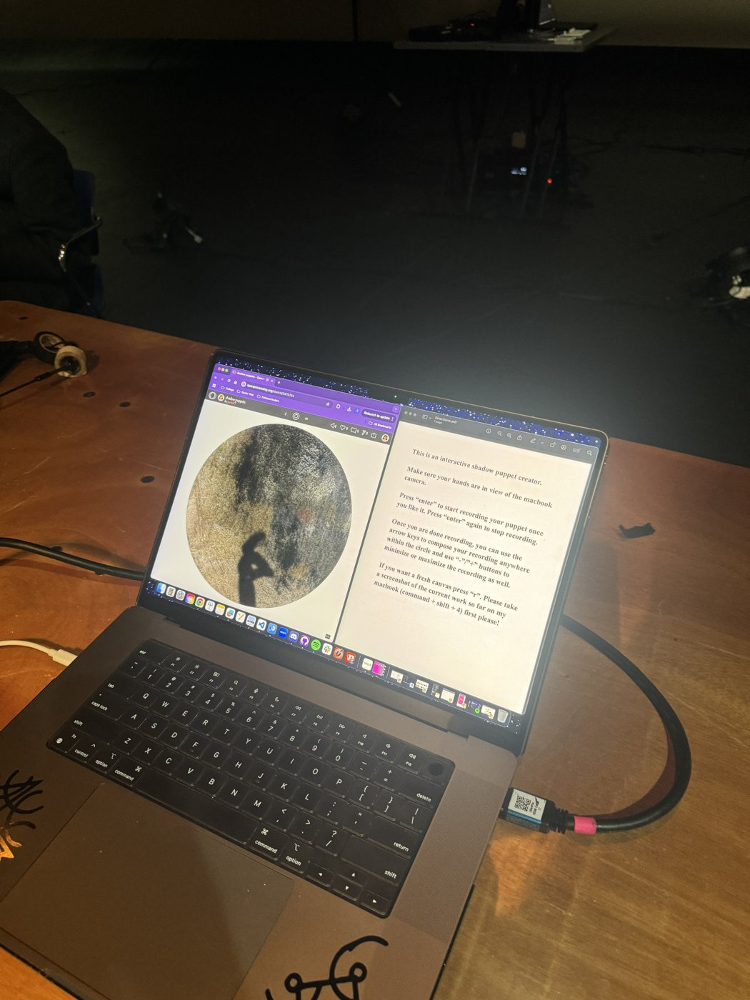

# Shadow Puppets

A sketch that allows you to create a shadow puppet story using your hands. Real-time hand tracking turns your hands into shadows on a cave wall, and you can record puppet motions, play them back, and move and resize them around the canvas. Exhibited at the WQED Center in Pittsburgh on December 7, 2024, as part of an interactive group show about projecting light and shadow.

**Try it live:** [jg3012736.github.io/shadow-puppets](https://jg3012736.github.io/shadow-puppets/) (allow camera access)

**Exhibition version:** [jg3012736.github.io/shadow-puppets/exhibition](https://jg3012736.github.io/shadow-puppets/exhibition/)

**Demo video:**

[](https://youtu.be/OMl1SEck59I)

* **Built with:** JavaScript, p5.js, ml5.js HandPose (MediaPipe runtime)
* **Features:** real-time tracking of up to two hands, shadow rendering on an offscreen graphics buffer with blur, gesture recording and looping playback, and repositioning and resizing of recorded puppets
* **Context:** Exhibited in an interactive group show at the WQED Center, Pittsburgh (December 7, 2024), hosted by Professor Johannes DeYoung. Project guided by Professor Golan Levin at Carnegie Mellon University.

## Exhibition



The exhibition version was projected as a large circle onto the studio wall, with a laptop station where visitors could step up and create their own puppets. ([Watch the full clip](media/exhibition.mp4))

| The exhibition space | The projection | The visitor station |
|---|---|---|
|  |  |  |

## Process

I had previously taken a class on Chinese shadow puppetry with Professor DeYoung and felt compelled to bring that visual language into this space. Instead of physical puppets, the puppets could be created with the software we were encouraged to explore. I was also inspired by Professor Levin's works that bring the movement and tracking of bodies into the digital space, and I wanted to combine the essence of both areas. The entire exhibition was about projecting light and shadow, so the piece needed to feel like a shadow being cast onto a cave wall.

The two hardest technical parts were:

1. **Making hands look like shadows, not skeletons.** I connected the ml5.js HandPose model and repeatedly tested it so the contour of the hands looked accurate to a real shadow instead of a tracked skeleton.
2. **The soft edge.** With help from Professor Levin, I tried different techniques to add a soft, blurred edge so the shadows looked like they were actually being projected onto a cave.

## Controls

* **Enter:** start recording a new puppet, then press Enter again to stop
* **Arrow keys:** move the last recorded puppet around the canvas
* **Click:** place the last recorded puppet where you click
* **+ / -:** make it bigger or smaller
* **a:** toggle arms
* **r:** clear all recordings

## Two Versions

* **Main version** (`/`): 800 x 600 canvas with on-screen directions. Works best on a laptop.
* **Exhibition version** (`/exhibition`): 1000 x 800 canvas with a circular mask, the version shown at WQED.

## Run Locally

The webcam only works over `https` or `localhost`, so serve the folder instead of opening the file directly:

```
python3 -m http.server 8000
```

Then visit http://localhost:8000 and allow camera access.

## Credits

* Hand tracking built on the [ml5.js HandPose](https://docs.ml5js.org/#/reference/handpose) model and example code (MIT License, Copyright (c) 2024 ml5)
* Originally made on [OpenProcessing](https://openprocessing.org/sketch/2510419)
